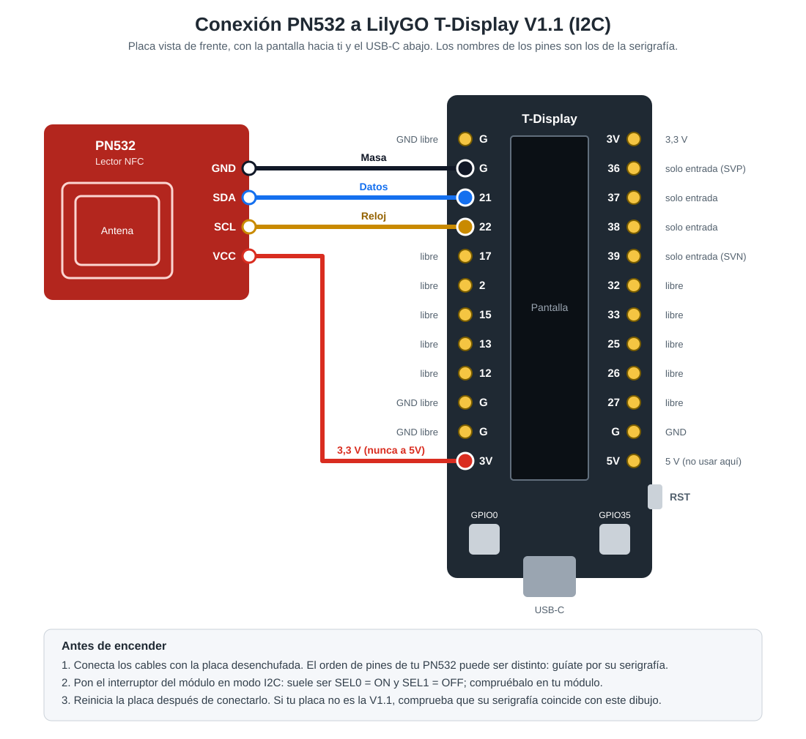

# bambuspoolreader

[Español](#español) · [English](#english)

---

## Español

Lector de etiquetas NFC de bobinas de filamento Bambu Lab basado en un ESP32. Al acercar una bobina, la pantalla muestra:

- **Material**, por ejemplo `PLA`, dentro de un panel con el color de la bobina que ocupa la mitad izquierda de la pantalla.
- **Nombre comercial**, por ejemplo `PLA Basic`, en la mitad derecha.
- **Indicador de batería**, en la esquina inferior derecha. Se actualiza cada minuto y muestra `USB` cuando la placa está alimentada por USB.

> **Estado:** el firmware compila y arranca, y la pantalla funciona en una T-Display V1.1. La lectura completa de una etiqueta real todavía no se ha probado con hardware.

### Hardware

| Componente | Detalles |
|---|---|
| Placa | [LilyGO T-Display V1.1](https://github.com/Xinyuan-LilyGO/TTGO-T-Display) (ESP32, 4 MB de flash) |
| Pantalla | Integrada: IPS ST7789V de 1,14", 135×240 |
| Lector NFC | Módulo PN532 en modo I2C |
| Batería (opcional) | LiPo de 3,7 V en el conector de batería de la placa |

### Conexiones

| PN532 | T-Display |
|---|---|
| GND | G |
| VCC | 3V (3,3 V; no uses 5V) |
| SDA | 21 |
| SCL | 22 |

El módulo PN532 debe estar en modo I2C (normalmente `SEL0 = ON` y `SEL1 = OFF`). Las conexiones deben ir soldadas.



### Compilar y grabar

Necesitas [ESP-IDF v5.5.6](https://docs.espressif.com/projects/esp-idf/en/v5.5.6/esp32/get-started/index.html).

```bash
. ~/esp/esp-idf/export.sh
idf.py build
idf.py -p /dev/ttyACM0 flash monitor
```

El puerto depende del chip USB de la placa: `/dev/ttyACM0` con CH9102 y `/dev/ttyUSB0` con CP210x. En Windows será un puerto `COMx`.

**Modo demo**: recorre varias bobinas de ejemplo sin necesidad de lector, para comprobar la pantalla. Los datos son inventados.

```bash
idf.py -DDEMO_TAGS=1 -p /dev/ttyACM0 flash   # activar
idf.py -DDEMO_TAGS=0 -p /dev/ttyACM0 flash   # volver al firmware normal
```

**Tests** de la lógica sin hardware, en el PC:

```bash
gcc -Wall -Wextra -Werror -Imain test/test_host.c main/bambu_tag.c -o test_host && ./test_host
```

### Si no detecta el lector

Si no encuentra el lector, la pantalla muestra el motivo:

| Pantalla | Causa probable |
|---|---|
| `SDA/SCL a masa` | Una línea tocando GND, o SDA/SCL mal conectados |
| `No conectado o sin 3V3` | Cables sueltos o sin soldar, o el módulo no recibe 3,3 V |
| `No esta en modo I2C` | El módulo responde eléctricamente, pero los interruptores no están en I2C (tras cambiarlos, quita y vuelve a dar alimentación) |
| `Direccion I2C distinta` | Hay otro dispositivo en el bus, pero no en la dirección 0x24 |
| `Lector NFC no responde` | El PN532 está en 0x24 pero no contesta a los comandos |

El log del puerto serie detalla cada paso: estado de SDA y SCL, escaneo del bus y el comando que falla. Para guardarlo en un fichero:

```bash
python tools/capture_log.py -p /dev/ttyACM0 -s 15 -o pn532.log
```

### Cómo funciona

Las etiquetas de Bambu Lab son MIFARE Classic 1K cifradas. La clave de cada sector se deriva del UID de la etiqueta con HKDF-SHA256, tal como documenta el proyecto [Bambu Research Group RFID Tag Guide](https://github.com/Bambu-Research-Group/RFID-Tag-Guide). El firmware lee tres bloques:

| Bloque | Contenido |
|---|---|
| 2 | Material |
| 4 | Nombre comercial |
| 5 | Color (RGBA) |

### Estructura

| Ruta | Contenido |
|---|---|
| `main/app_main.c` | Bucle principal y tarea de batería |
| `main/pn532.c` | Driver del PN532 por I2C |
| `main/bambu_tag.c`, `main/bambu_keys.c` | Interpretación de la etiqueta y derivación de claves |
| `main/display.c` | Pantalla con LVGL |
| `main/battery.c` | Lectura de batería |
| `main/board.h` | Pines |
| `test/test_host.c` | Tests en el PC |
| `docs/` | Diagrama de conexión |

---

## English

NFC tag reader for Bambu Lab filament spools, built on an ESP32. When you hold a spool near the reader, the screen shows:

- **Material**, e.g. `PLA`, inside a panel filled with the spool's color on the left half of the screen.
- **Product name**, e.g. `PLA Basic`, on the right half.
- **Battery indicator** in the bottom-right corner. It refreshes every minute and shows `USB` when the board runs on USB power.

> **Status:** the firmware builds and boots, and the display works on a T-Display V1.1. Reading a real tag end to end has not been tested on hardware yet.

### Hardware

| Part | Details |
|---|---|
| Board | [LilyGO T-Display V1.1](https://github.com/Xinyuan-LilyGO/TTGO-T-Display) (ESP32, 4 MB flash) |
| Display | Built in: 1.14" IPS ST7789V, 135×240 |
| NFC reader | PN532 module in I2C mode |
| Battery (optional) | 3.7 V LiPo on the board's battery connector |

### Wiring

| PN532 | T-Display |
|---|---|
| GND | G |
| VCC | 3V (3.3 V; do not use 5V) |
| SDA | 21 |
| SCL | 22 |

The PN532 module must be set to I2C mode (usually `SEL0 = ON`, `SEL1 = OFF`). Solder the connections.

See the [wiring diagram](docs/conexion-pn532.svg) (labels in Spanish).

### Build and flash

You need [ESP-IDF v5.5.6](https://docs.espressif.com/projects/esp-idf/en/v5.5.6/esp32/get-started/index.html).

```bash
. ~/esp/esp-idf/export.sh
idf.py build
idf.py -p /dev/ttyACM0 flash monitor
```

The port depends on the board's USB chip: `/dev/ttyACM0` for CH9102, `/dev/ttyUSB0` for CP210x. On Windows it is a `COMx` port.

**Demo mode** cycles through sample spools without a reader, to check the display. The data is made up.

```bash
idf.py -DDEMO_TAGS=1 -p /dev/ttyACM0 flash   # enable
idf.py -DDEMO_TAGS=0 -p /dev/ttyACM0 flash   # back to normal firmware
```

**Tests** for the hardware-independent logic, run on your computer:

```bash
gcc -Wall -Wextra -Werror -Imain test/test_host.c main/bambu_tag.c -o test_host && ./test_host
```

### If the reader is not detected

If the reader is not found, the screen shows why:

| Screen | Likely cause |
|---|---|
| `SDA/SCL a masa` | A line touching GND, or SDA/SCL miswired |
| `No conectado o sin 3V3` | Loose or unsoldered wires, or the module gets no 3.3 V |
| `No esta en modo I2C` | The module is wired, but its switches are not set to I2C (power-cycle it after changing them) |
| `Direccion I2C distinta` | Another device is on the bus, but not at address 0x24 |
| `Lector NFC no responde` | The PN532 is at 0x24 but does not answer commands |

The serial log details each step: SDA and SCL state, bus scan and the failing command. To save it to a file:

```bash
python tools/capture_log.py -p /dev/ttyACM0 -s 15 -o pn532.log
```

### How it works

Bambu Lab tags are encrypted MIFARE Classic 1K. Each sector key is derived from the tag UID with HKDF-SHA256, as documented by the [Bambu Research Group RFID Tag Guide](https://github.com/Bambu-Research-Group/RFID-Tag-Guide). The firmware reads three blocks:

| Block | Content |
|---|---|
| 2 | Material |
| 4 | Product name |
| 5 | Color (RGBA) |

### Layout

| Path | Content |
|---|---|
| `main/app_main.c` | Main loop and battery task |
| `main/pn532.c` | PN532 I2C driver |
| `main/bambu_tag.c`, `main/bambu_keys.c` | Tag parsing and key derivation |
| `main/display.c` | Display with LVGL |
| `main/battery.c` | Battery reading |
| `main/board.h` | Pin assignments |
| `test/test_host.c` | Host tests |
| `docs/` | Wiring diagram |
